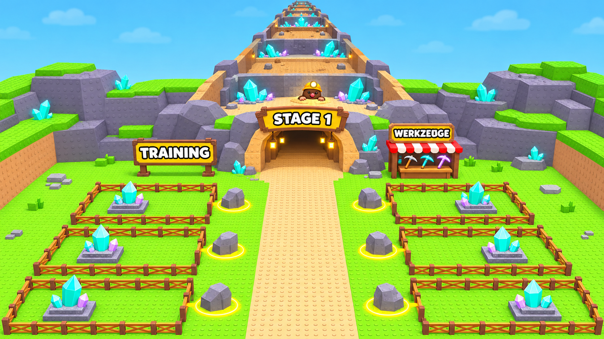
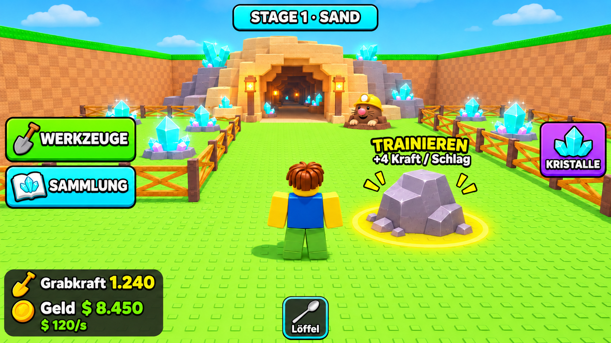
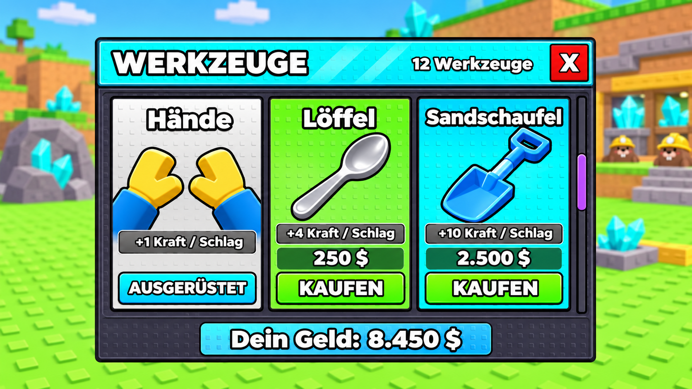

# Steal a Crystal

Ein buntes Roblox-Spiel für besonders junge Kinder: Trainiere deine Grabkraft, grabe dich durch immer härtere Tunnel, hole Kristalle aus den Schatzhöhlen freundlicher Maulwurf-Wächter und baue in deiner Basis ein steigendes Einkommen auf.

**Projektstand: Planung, visuelle Entwürfe und Rojo-Vorbereitung, noch keine Spielimplementierung.** Stand: 7. November 2026. Aktueller Arbeits- und Prüfstand: [STAND.md](STAND.md).

**Neue Priorität:** Eine kleine spielbare Version in ungefähr einer Woche fertigstellen. Bei einem Start am 7. November ist der Zieltermin der 14. November 2026. Der Nutzer akzeptiert wenig Feinschliff und plant zunächst nur mit einigen Wochen Nutzung. Umfang und Wiederverwendung richten sich danach. Der Termin ist ein Entwicklungsziel, keine Zusage für Spielerzahlen oder eine Freigabe durch Roblox.

## Der Spielablauf

**Am Trainingsstein trainieren → Tunnel durchgraben → Kristall beim Maulwurf holen → zur Basis bringen → Geld pro Sekunde verdienen → besseres Trainingswerkzeug kaufen.**

- 12 Stages und 12 Trainingswerkzeuge.
- Grabkraft als einziger Leistungswert für das Vorankommen durch die Tunnel.
- Werkzeuge verbessern den Kraftgewinn beim Training.
- Werkzeugkäufe sind ausschließlich vom Spielgeld abhängig, nicht von einer erreichten Stage.
- Kristalle ersetzen die Eier und Haustiere des Vorbilds als Sammelobjekte und Einkommensquelle.
- Kleine, freundliche Maulwürfe bewachen die Kristalle.

## Was in diesem Repository liegt

Hier werden nur Inhalte zu **Steal a Crystal** aufbewahrt. Dazu gehören die ausdrücklich gewünschte Inspiration durch **Steal an Egg**, die eigenen Spielregeln, relevante Entscheidungen und offene Fragen sowie Referenzen und Entwürfe. Andere im Gespräch erwähnte Spielideen und ein vollständiges Chatarchiv sind nicht enthalten.

| Dokument | Inhalt |
| --- | --- |
| [STAND.md](STAND.md) | Gemeinsame Übergabe: letzte Arbeit, Prüfungen, offene Probleme und nächster Schritt |
| [Rojo-Einrichtung](docs/ROJO.md) | Projektdatei, feste Werkzeugversion, Codeordner und Studio-Verbindung |
| [Wochenplan](docs/WEEK_PLAN.md) | Kleiner Veröffentlichungsumfang, Arbeitspakete und Fertigkriterien |
| [Spielkonzept](docs/GAME_DESIGN.md) | Aktueller Ablauf, Systeme und Grenzen |
| [Entscheidungsregister](docs/DECISIONS.md) | Beschlossene Regeln und korrigierte Annahmen innerhalb dieses Projekts |
| [Inspiration und Übertragung](docs/INSPIRATION.md) | Was von Steal an Egg stammt und wie es angepasst wird |
| [Offene Fragen](docs/OPEN_QUESTIONS.md) | Noch zu klärende Spiel- und Umsetzungsregeln |
| [Fortschritt und Werte](docs/BALANCE.md) | Werkzeuge, Beispielwerte und noch offene Zahlen |
| [Visuelle Vorlagen](docs/design/README.md) | Map, Spieloberfläche und Werkzeugshop samt Nachbauvorgaben |
| [Screenshot-Analyse](docs/REFERENCE_ANALYSIS.md) | Sichtbare Funktionen des Vorbilds und Grenzen der Bildbelege |
| [Referenzverzeichnis](references/manifest.json) | Dateinamen und Prüfsummen der ursprünglichen Screenshots |

## Visuelle Richtung

Die erste Bildserie wurde vom Nutzer positiv bestätigt. Damit ist die bunte, blockige Kristallminen-Optik die bevorzugte Richtung. Die sechs Basen und die gezeigten Preise sind weiterhin Entwurfsannahmen, keine endgültigen Festlegungen.

### Mapübersicht

### Spieloberfläche

### Werkzeugshop

## Zusammenarbeit

Beide Assistenten lesen vor Arbeitsbeginn [STAND.md](STAND.md) und aktualisieren die Datei nach Änderungen. Das gilt auch für Arbeiten direkt in Roblox Studio. Aktive Arbeit und überprüfte Ergebnisse müssen erkennbar sein.

ChatGPT/Codex unterstützt vor allem Spiel- und UI-Planung, Dokumentation und Prüfung. Claude Code soll hauptsächlich Programmierung, Roblox-Studio-Umsetzung und 3D-Gestaltung übernehmen. Beide arbeiten mit derselben Dokumentation.

Selbstständige Arbeitsphasen sind auf höchstens vier Stunden zu begrenzen. Projektstand und offene Aufgaben werden am Ende dokumentiert. Eine technische Zeitbegrenzung oder automatische Agentenkoordination ist noch nicht eingerichtet.

Das vom Nutzer angelegte Repository ist [Valentindghjg/Steal-a-Crystal](https://github.com/Valentindghjg/Steal-a-Crystal) und ist aktuell öffentlich.

## Verbindlichkeit

Explizite Nutzerentscheidungen haben Vorrang vor früheren Assistentenvorschlägen und Bilddetails. „Offen“ oder „Vorschlag“ bedeutet nicht beschlossen. Vor der Entwicklung des jeweiligen Systems sind seine offenen Abhängigkeiten zu klären. Startwerte für die Wirtschaft werden geplant und später im spielbaren Prototyp abgestimmt.
